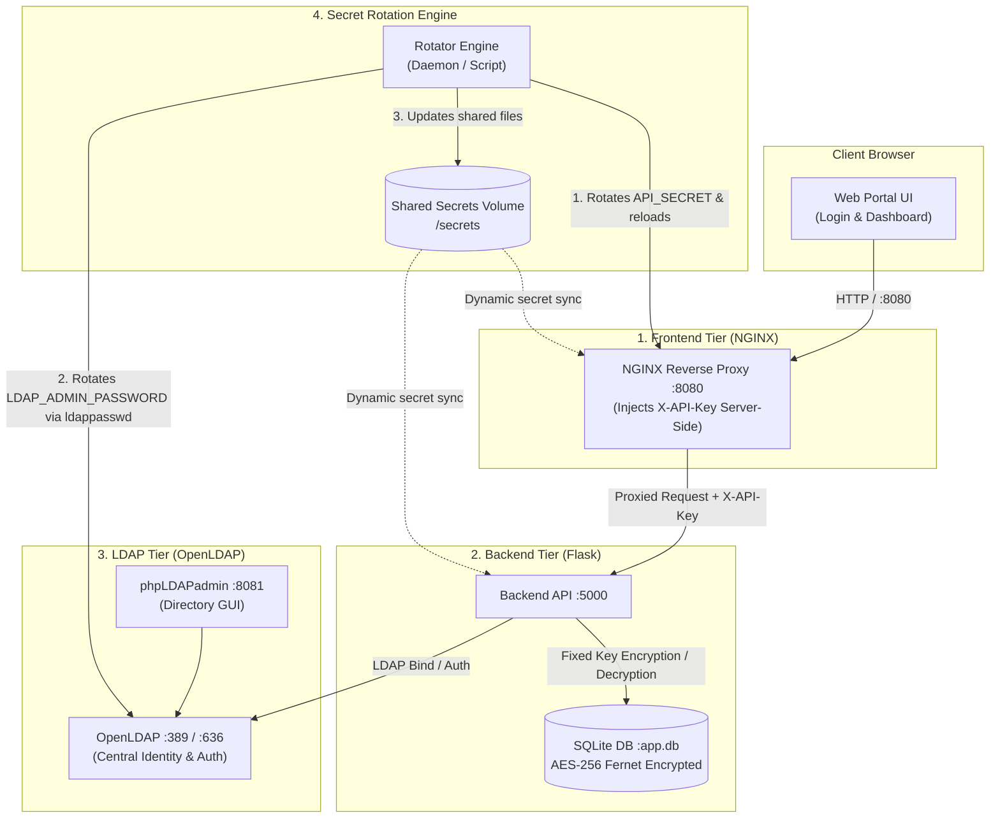

# Integrated Cybersecurity Lab: LDAP Authentication & 3-Service Secret Rotation

An integrated enterprise security architecture featuring **centralized LDAP identity authentication**, **application-level AES-256 database encryption**, and **automated zero-downtime secret rotation** across three architectural tiers.

---

## 🏗️ Project Architecture



---

## 📁 Repository Directory Structure

```text
ldap-secret-rotation-lab/
│
├── docker-compose.yml              # Multi-container orchestration
├── .env                            # Active environment variables
├── .env.example                    # Environment variable template
├── README.md                       # Comprehensive lab documentation
│
├── Frontend/                       # 1. FRONTEND SERVICE
│   ├── Dockerfile                  # NGINX alpine container
│   ├── nginx.conf.template         # Dynamic proxy configuration template
│   ├── docker-entrypoint.sh        # Secret injection startup script
│   ├── index.html                  # Responsive Login & Security Dashboard UI
│   ├── styles.css                  # Modern cybersecurity dark theme styling
│   └── app.js                      # Client authentication & API handlers
│
├── Backend/                        # 2. BACKEND SERVICE
│   ├── Dockerfile                  # Python 3.11 Alpine container
│   ├── requirements.txt            # Flask, Flask-CORS, Cryptography, LDAP3
│   ├── docker-entrypoint.sh        # Backend startup & secret loading
│   └── app.py                      # Flask REST API with LDAP auth & AES-256 DB
│
├── LDAP/                           # 3. LDAP SERVICE
│   ├── users.ldif                  # Pre-seeded users (alice, bob) and groups
│   ├── bootstrap.sh                # Directory initialization helper
│   └── README.md                   # LDAP documentation
│
└── SecretRotation/                 # 4. SECRET ROTATION REPOSITORY
    ├── Dockerfile                  # Standalone rotation container
    ├── rotate-all.sh               # 3-Service coordinated rotation orchestrator
    ├── rotate-frontend.sh          # Frontend NGINX API secret rotator
    ├── rotate-ldap.sh              # OpenLDAP admin password rotator
    ├── rotate-daemon.sh            # Background rotation loop (2-min interval)
    └── README.md                   # Rotation documentation & audit logs
```

---

## 🔐 Credentials & Seed Accounts

### Standard LDAP Users (Classroom Lab)
| Username | Password | Email | Role | Group |
|---|---|---|---|---|
| `alice` | `alice123` | `alice@example.com` | User | `developers` |
| `bob` | `bob123` | `bob@example.com` | User | `developers` |

### LDAP Administrator
- **DN**: `cn=admin,dc=example,dc=com`
- **Initial Password**: `adminpassword` *(rotates automatically)*

---

## 🚀 Quick Start Guide

### 1. Launch All Services
From the `ldap-secret-rotation-lab/` directory:

```bash
docker compose up -d --build
```

### 2. Access the Applications
| Service | URL | Description |
|---|---|---|
| **Web Portal & Login** | [http://localhost:8080](http://localhost:8080) | Interactive frontend with LDAP login & encrypted storage |
| **phpLDAPadmin** | [http://localhost:8081](http://localhost:8081) | OpenLDAP web management interface |
| **Backend Health Check**| [http://localhost:8080/api/health](http://localhost:8080/api/health) | Verifies SQLite & LDAP connections |
| **3-Service Status** | [http://localhost:8080/api/status](http://localhost:8080/api/status) | Inspects active secrets across all 3 services |

---

## 🔄 Secret Rotation Overview

The lab manages secrets across 3 distinct lifecycles:

| Service / Secret | Secret Variable | Rotation Behavior | Impact on Encryption |
|---|---|---|---|
| **1. Frontend Proxy** | `API_SECRET` (`X-API-Key`) | 🔄 Rotates every 120s | Zero downtime; NGINX reloads gracefully |
| **2. LDAP Directory** | `LDAP_ADMIN_PASSWORD` | 🔄 Rotates dynamically | `ldappasswd` updates live OpenLDAP entry |
| **3. Backend SQLite** | `DATABASE_ENCRYPTION_KEY` | 🔒 **FIXED (NEVER ROTATED)** | Preserves AES-256 Fernet ciphertext readability |

### Trigger Manual Rotation
To run an immediate rotation cycle on demand:

```bash
docker exec security_rotator /bin/sh /rotation/rotate-all.sh
```

---

## 🧪 Security & Verification Steps

1. **Verify LDAP Login**:
   - Open [http://localhost:8080](http://localhost:8080).
   - Click the quick-fill button for **Alice** (`alice` / `alice123`) and click **Authenticate**.
   - Confirm successful login showing user name, LDAP DN, and groups.

2. **Verify AES-256 Database Encryption**:
   - Submit a new confidential record from the dashboard form.
   - Click **Retrieve & Decrypt Records** to verify the plaintext is decrypted on the fly.
   - Click **Inspect Raw SQLite Disk Ciphertexts** to confirm only encrypted ciphertext is stored on disk.

3. **Verify Zero-Downtime Secret Rotation**:
   - Watch the 3-service rotation badges update periodically (or trigger manual rotation).
   - Re-fetch records to confirm decryption continues working without errors while `API_SECRET` and `LDAP_ADMIN_PASSWORD` rotate.

---

## 🛑 Teardown

```bash
docker compose down
```

To remove all persistent data (LDAP directories, database, secrets):
```bash
docker compose down -v
```
